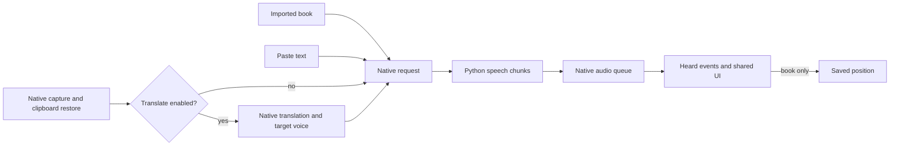

# ReadEase — App logic map

## Start here

ReadEase has one text-to-speech transport with document, Paste and selection inputs. Read is the common entry; Move notes and software updates are separate jobs. Use this map to find the owner, then read only the relevant contract.

| Question | Rule owner |
|---|---|
| where to start, reopen content, or show recents? | [Read home](../../logic/home.md) |
| how does a document enter/leave durable storage? | [Library](../../logic/library.md) |
| what is read, paused, cancelled or saved as heard? | [Playback](../../logic/reading.md) |
| which translation/provider/target voice is eligible? | [Selection translation](../../logic/translation.md) |
| how are WAV/SRT/M4B written, reviewed and cancelled? | [Audio export](../../logic/export.md) |
| which model/voice/key/price can be used? | [Voices and models](../../logic/voices.md) |
| what survives note edits/sync/edition transfer? | [Notes](../../logic/notes.md) |
| when may an update install/restart? | [Updates](../../logic/updates.md) |
| what reaches the feedback site or local log? | [Help](../../logic/help.md) |
| what pasted/scanned text is kept, and for how long? | [History](../../logic/history.md) |

Each rule has one definition. File moves keep existing IDs and source/test annotations. Presentation belongs to [UX](../../ux/reading.md), rationale to [decisions](../../decisions.md), distribution to [releases](../../releases.md); history is not current acceptance evidence.

## Common pipeline

Opening a workspace/content does not start speech. A displayed page is not heard progress. Request/segment/capture/job identities must match before applying asynchronous results; the owning contract specifies how.

## Data lifetime

| Data | Owner / lifetime |
|---|---|
| books, segments, language override, heard progress | managed library/SQLite; persistent; originals unchanged |
| annotations, local edits and deletion tombstones | library repository; persistent |
| voice/rate, language choices, favorites, pronunciation, translation setup | engine configuration; preferences, not passage history |
| theme, reading layout, sidebar, chapter scope, updater policy | webview preference storage |
| draft, request/origin/position | App memory/native transport; session only; no passage cache/library row |
| paste/scan history (text, original, translation) | [`history.sqlite3`](../../logic/history.md), owner-only; on by default, retention 7/30/90/365 days or until deleted; never audio |
| Home recents | derived, no second store; book timestamps and kept history survive, an unsaved draft does not |
| export job/review audio | app-wide job + temporary audio/session; chosen output files persist; no relaunch resume |
| updater archive/armed quit | updater/native session; auto policy persists, no guaranteed transfer resume |

[Privacy](../../../../PRIVACY.md) owns network disclosure. Feature documents specify only their additional eligibility, storage or recovery constraints.

## Operation precedence

1. [Export](../../logic/export.md#states-and-recovery) owns the voice until receipt/EOF; browsing/configuration stay available. It takes priority over quit and update apply.
2. [Playback](../../logic/reading.md#states-and-recovery) and [translation](../../logic/translation.md#states-and-recovery) supersede old generations; navigation alone does not cancel them.
3. [Updater](../../logic/updates.md#states-and-recovery) preparation coexists with app use. Applying is explicit and export-guarded; restart loses session text.

Without export/update interception, the single main window normally closes the app. Their owning documents define minimize, confirmation and installation handling.

## Status and verification

- `live`: implemented with code/test evidence; not a claim of release or every manual acceptance check. `not built`: unsupported implementation. `blocked`: the complete rule cannot yet be accepted; its owner states why.
- Read home/background updater are unreleased in this checkout. Preserve pending [native control acceptance](../../logic/reading.md#native-controls-and-acceptance), [translation acceptance](../../logic/translation.md#evidence) and [signed upgrade acceptance](../../logic/updates.md#evidence).
- Chapter scope is carried page → native → engine and pinned by a source-reading contract test (RE-PLAY-027).
- For docs: validate unique definitions, retained IDs/status/evidence, paths/anchors and relations. For behavior: run relevant unit/contract checks and repository verification; visible changes also need interaction/render checks. Neither source nor fixture success substitutes for native acceptance.

## Change log

- 2026-10-20: paste/scan history kept on this Mac (RE-HIST-001…004).
- 2026-10-20: chapter-scope mismatch closed (RE-PLAY-027).
- 2026-10-20: shortened the map to ownership/lifetime/precedence and linked detail owners; stable IDs retained.
- 2026-10-19: documented the current app boundaries and known gaps.
