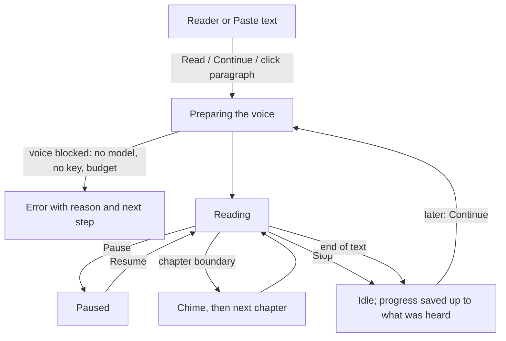

# ReadEase — Reading and playback (UX)

> Feature master: read this file first to understand how ReadEase reads text aloud. Deeper rules live in
> `logic/reading.md`.

## Purpose
- Problem: listening to a long text only works if the voice keeps its place, pauses where the text pauses, and never
  loses where the reader was.
- Audience: anyone listening to a book, a document or pasted text.
- Success signal: press Read, listen to a chapter, quit, come back - it continues where the ear stopped.

## Scope
- Included: the Reader (a book open from the Library), Paste text, the shared control bar (transport) and the floating
  reading status, chapter/section sounds, speed, resume.
- Excluded: choosing and downloading voices (`ux/voices.md`); importing (`ux/library.md`); the Read a selection screen
  and its global shortcut are noted only where they share the transport.

## Current truth
- **Reader**: the book shows as pages with the paragraph being read highlighted. Click a paragraph to read from there;
  **Continue** resumes from the saved place, **Read from the start** starts over. A side column holds Contents, Notes
  and Search; a search result or note picked mid-listen keeps the page where the reader went, and "back to where the
  voice is" returns to it.
- **Sidebar collapse and expand**: the Reader uses the same 80px folded icon rail as the Library and other screens.
  The top switch and ⌥⌘S fold/unfold it; the edge can be dragged in to fold and out to expand, and double-click
  restores the default width when open. Contents, Notes and Search icons open their own list; the top switch
  restores the last list. The same chosen width (200–400px, default 240px) and open/closed preference carry between
  the Library and Reader. Folded, voice/model settings and appearance stay at the rail's foot; language moves to
  the toolbar. Window buttons remain above the rail, so the Reader toolbar does not jump to a different inset.
- **Folded Reader previews**: hovering Contents, Notes or Search for 180ms opens that existing list in a glass
  panel beside the 80px rail, without resizing the page or changing the saved sidebar preference. Moving into
  the panel keeps it open; leaving both regions closes it after 240ms. Pointer hover or keyboard focus inside
  keeps it available, including when focus moves out while the pointer stays over the panel. Escape, Close, an outside click, another chrome panel or a book/screen change
  dismisses it. Search clears its query on the first Escape and closes on the next; hovering never steals focus.
  Clicking a rail icon, using the keyboard shortcuts or the panel's expand button opens the normal column;
  expanding a search preview preserves its query and selected result. Only one list is mounted, through the
  Reader's existing portal; preview timers and dismissal listeners are cleaned up, with no pointermove layout
  measurements or preference writes. The panel uses the shared sheet/glass surface, a fixed heading and a
  vertically scrolling body, inset 12px from both the window and the rail (minimum width 320px, viewport capped).
- **Reader popovers**: Reading settings, Voice settings, Cost and scope, and Export audiobook share one open
  popover. Opening another replaces the current one; pressing the active opener toggles it closed. Escape, the close
  button and a click back onto the document dismiss it. A nested Voice picker keeps its own parent panel and closes
  first on Escape. Navigation clears the popover. All use the shared glass surface, sheet radius, 24px horizontal
  inset and a 12px gap measured from the toolbar/transport controls. Long bodies scroll vertically within the space
  between the bars; the heading and close control stay visible. Export also keeps its action footer visible.
  Chrome geometry is observed on resize and coalesced to one frame; playback position and popover toggles do not
  recreate its observer or synchronously measure the bars on every render.
- **Transport** (bottom control bar, shared by Reader, Paste text and Read a selection): Read / Pause / Resume / Stop,
  Previous / Next, speed, voice and voice settings. A floating capsule above the bar shows Preparing the voice… /
  Reading / Reading paused, with a return-to-source action; it steps aside while a panel is open over the bar.
- **Pauses follow the text structure**: longest at a chapter, then paragraph, heading, list item, sentence. Headings are
  read a touch slower and louder. A new chapter opens with a short chime (marimba, harp, piano or none); a first-level
  section with a shorter, softer one. Faster speed shortens the pauses.
- **Notes and citations**: bibliographic footnotes are not read, remarks keep their first two sentences, in-text
  citations are skipped - configurable in Voice settings. The text on the page never changes.
- **Pronunciations** (Voice settings → "Pronunciations", Edit…): the reader writes a word as it appears and how it
  should be said ("ReadEase → rít ít"). Every reading and export says it that way from the next press of Read; the page
  and subtitles keep the written word. The row says how many words are set. Logic: RE-PLAY-015.
- **EPUB figures** are shown in reading order, numbered (Figure 1, Figure 2…) and announced in place.
- **Paste text → Export audio**: a button at the right of the character count ("Xuất âm thanh"; with a paid voice it
  carries the same price as the read button). It opens the macOS save panel (proposed name "ReadEase <date> <time>.wav"),
  then shows "Exporting n/N" with a bar and Cancel in the app-wide export receipt; the read button waits while it runs. Done: "Saved ~N min of
  audio and subtitles" with Show in Finder. The `.srt` lands beside the `.wav`. Logic: RE-PLAY-010…014.
  The job belongs to the app, not the screen: leave Paste text mid-export and come back to the same progress or result.
- **Reader → Export audiobook…**: select first/last chapter (the initial range is the whole book), then choose
  where to save an M4B. The popover separates the book heading, a labelled voice/speed/format summary, the chapter
  range, background-work guidance and a bordered action footer. Sections have 24px gaps; the body scrolls within a
  height limit on short windows, keeping the header and export action visible. The voice summary uses the shared
  compact name; the book title wraps. A paid voice shows an explanation and cannot start.
  Use Voice settings to select a downloaded on-device voice before exporting. JPEG/PNG cover is included if available.
- **Background export receipt**: stays above the transport on every screen, including the library. Names the book,
  shows completed/total text parts while generating voice, then separate indeterminate "Normalising loudness…" and
  "Writing the M4B audiobook…" stages. Elapsed time updates once a second inside this component; it is not an ETA.
  A book or another screen can be opened while exporting; all playback waits for the export. Cancel says "Cancelling
  and clearing temporary files…" until the final engine receipt. Done offers Show in Finder; errors/cancellation stay
  until dismissed. A failed/cancelled book export preserves an existing destination file.
- **Window and quit**: minimise or close the window and the export continues while ReadEase stays open. Installing/restarting an update waits for export completion. Quit asks
  Keep exporting / Cancel export and quit; the latter waits for cancellation. Completion or failure requests Dock
  attention when the window is not focused. There is no system notification banner or permission prompt. Keep the Mac
  awake; force quit, power loss and app relaunch do not resume an interrupted job.
- **Review sentences** (after an export, beside Show in Finder): a panel lists the export's sentences. ▶ plays a sentence
  as it is in the file (Stop while it plays); "Say again" (local VieNeu voices only - Kokoro says a sentence the same way
  every time and a paid voice would bill unquoted, and the caption says so) replaces it with a new take, marked "new
  take". Nothing reaches the WAV until "Save file", which rewrites WAV and subtitles with the progress above; the
  footer says how many takes are waiting. "Done" ends the review; changing the pasted text or exporting again ends it
  too. Logic: RE-PLAY-016.
  Known limits (2026-10-14): Cancel shown while the file is being saved again does nothing until the write ends (a
  few seconds even for a long file); a "Say again" after five quiet minutes reloads the voice first; switching the
  model build restarts the engine and ends the review (the next action says so); the list is not virtualised, so a
  very long export lists thousands of rows; where the written and spoken sentences do not pair up, a row shows the
  spoken words (a pronunciation then appears as said).
  While an export runs, every read in the app waits: the read buttons are disabled and a paragraph click does nothing.
  With a paid voice whose price could not be fetched, Export stays disabled and says "no price yet".
  Known limits (2026-10-14): the global Read a selection shortcut and a voice sample still queue behind an export (shown
  as "preparing" until it ends), and Cancel drops them too; a name typed without `.wav` gets it appended after the save
  panel's overwrite check.
- **Paste text**: up to 100,000 characters; paragraph breaks kept; long text is split into parts ("Reading part 2/7").
  Markdown is read as meant (marks dropped, link text read, not the address). Pasted text is not added to the Library,
  not logged and not written to the audio cache.
- **Progress** is saved per book from what was actually heard, not from what was synthesized ahead.

## Screens and states
| Screen | States | Entry | Exit / next |
|---|---|---|---|
| Reader | idle · preparing voice · reading · paused · error (reason shown, e.g. missing model, no key, budget) | open a book from the Library | back to Library; side column Contents / Notes / Search |
| Paste text | empty · text entered · over the limit (count + "trim it") · reading part N/M · paused · exporting n/N · exported (Show in Finder) · export failed (reason) | side column "Paste text" | stop, or switch tab (an export goes on) |
| Control bar (transport) | idle · reading · paused (pause button shows Resume) | always present on reading screens | Stop → idle |
| Reading status capsule | preparing · reading · paused · hidden while a panel covers the bar | a reading starts | Stop removes it |
| Voice settings panel | open · closed | gear on the control bar | closes back to the screen |

## Flow

## Reading order
| File | Role |
|---|---|
| this file | current truth |
| `logic/reading.md` | rules + REQ-IDs |
| `docs/markdown-speech.md` | Markdown-to-speech detail |
| `docs/readease-hig.md` | the app's interface guidelines |

## Change log
- 2026-10-15: Reader audit: exclusive chrome popovers, shared measured anchors and capped bodies; resize-driven chrome measurement.
- 2026-10-15: Reader and app navigation share the folded icon rail and collapse/expand interactions.
- 2026-10-15: background M4B export sheet, global receipt and close/quit behaviour.
- 2026-10-10: created from code and CHANGELOG as of v0.1.21.
