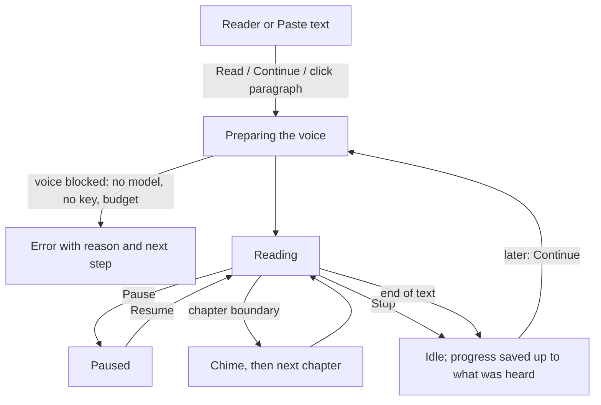

# ReadEase — Reading and playback (UX)

> Feature master: read this file first to understand how ReadEase reads text aloud. Deeper rules live in
> [playback](../logic/reading.md), [translation](../logic/translation.md) and [export](../logic/export.md).

## Purpose
- Problem: listening to a long text only works if the voice keeps its place, pauses where the text pauses, and never
  loses where the reader was.
- Audience: anyone listening to a book, a document or pasted text.
- Success signal: press Read, listen to a chapter, quit, come back - it continues where the ear stopped.

## Scope
- Included: the Reader (a book open from the Library), Paste text, the shared control bar (transport) and the floating
  reading status, chapter/section sounds, speed, resume.
- Excluded: choosing and downloading voices (`ux/voices.md`); importing (`ux/library.md`); the Read a selection screen
  and its global shortcut are noted only where they share the transport.

## Current truth
- **Reader**: the book shows as pages with the paragraph being read highlighted. Click a paragraph to read from there;
  **Continue** resumes from the saved place, **Read from the start** starts over. A side column holds Contents, Notes
  and Search; a search result or note picked mid-listen keeps the page where the reader went, and "back to where the
  voice is" returns to it.
- **Sidebar collapse and expand**: the Reader uses the same 80px folded icon rail as the Library and other screens.
  The top switch and ⌥⌘S fold/unfold it; the edge can be dragged in to fold and out to expand, and double-click
  restores the default width when open. Contents, Notes and Search icons open their own list; the top switch
  restores the last list. The same chosen width (200–400px, default 240px) and open/closed preference carry between
  the Library and Reader. Folded, voice/model settings and appearance stay at the rail's foot; language moves to
  the toolbar. Window buttons remain above the rail, so the Reader toolbar does not jump to a different inset.
- **Folded Reader previews**: hovering Contents, Notes or Search for 180ms opens that existing list in a glass
  panel beside the 80px rail, without resizing the page or changing the saved sidebar preference. Moving into
  the panel keeps it open; leaving both regions closes it after 240ms. Pointer hover or keyboard focus inside
  keeps it available, including when focus moves out while the pointer stays over the panel. Escape, Close, an outside click, another chrome panel or a book/screen change
  dismisses it. Search clears its query on the first Escape and closes on the next; hovering never steals focus.
  Clicking a rail icon, using the keyboard shortcuts or the panel's expand button opens the normal column;
  expanding a search preview preserves its query and selected result. Only one list is mounted, through the
  Reader's existing portal; preview timers and dismissal listeners are cleaned up, with no pointermove layout
  measurements or preference writes. The panel uses the shared sheet/glass surface, a fixed heading and a
  vertically scrolling body, inset 12px from both the window and the rail (minimum width 320px, viewport capped).
- **Reader popovers**: Reading settings, Voice settings, Cost and scope, and Export audiobook share one open
  popover. Opening another replaces the current one; pressing the active opener toggles it closed. Escape, the close
  button and a click back onto the document dismiss it. A nested Voice picker keeps its own parent panel and closes
  first on Escape. Navigation clears the popover. All use the shared glass surface, sheet radius, 24px horizontal
  inset and a 12px gap measured from the toolbar/transport controls. Long bodies scroll vertically within the space
  between the bars; the heading and close control stay visible. Export also keeps its action footer visible.
  Chrome geometry is observed on resize and coalesced to one frame; playback position and popover toggles do not
  recreate its observer or synchronously measure the bars on every render.
- **Transport** (bottom control bar, shared by Reader, Paste text and Read a selection): Read / Pause / Resume / Stop,
  Previous / Next, speed, voice and voice settings. A floating capsule above the bar shows Preparing the voice… /
  Reading / Reading paused, with a return-to-source action; it steps aside while a panel is open over the bar.
- **Pauses follow the text structure**: longest at a chapter, then paragraph, heading, list item, sentence. Headings are
  read a touch slower and louder. A new chapter opens with a short chime (marimba, harp, piano or none); a first-level
  section with a shorter, softer one. Faster speed shortens the pauses.
- **Notes and citations**: bibliographic footnotes are not read, remarks keep their first two sentences, in-text
  citations are skipped - configurable in Voice settings. The text on the page never changes.
- **Pronunciations** (Voice settings → "Pronunciations", Edit…): the reader writes a word as it appears and how it
  should be said ("ReadEase → rít ít"). Every reading and export says it that way from the next press of Read; the page
  and subtitles keep the written word. The row says how many words are set. Logic: RE-PLAY-015.
- **EPUB figures** are shown in reading order, numbered (Figure 1, Figure 2…) and announced in place.
- **Paste text → Export audio**: a button at the right of the character count ("Xuất âm thanh"; with a paid voice it
  carries the same price as the read button). It opens the macOS save panel (proposed name "ReadEase <date> <time>.wav"),
  then shows "Exporting n/N" with a bar and Cancel in the app-wide export receipt; the read button waits while it runs. Done: "Saved ~N min of
  audio and subtitles" with Show in Finder. The `.srt` lands beside the `.wav`. Logic: RE-PLAY-010…014.
  The job belongs to the app, not the screen: leave Paste text mid-export and come back to the same progress or result.
- **Reader → Export audiobook…**: select first/last chapter (the initial range is the whole book), then choose
  where to save an M4B. The popover separates the book heading, a labelled voice/speed/format summary, the chapter
  range, background-work guidance and a bordered action footer. Sections have 24px gaps; the body scrolls within a
  height limit on short windows, keeping the header and export action visible. The voice summary uses the shared
  compact name; the book title wraps. A paid voice shows an explanation and cannot start.
  Use Voice settings to select a downloaded on-device voice before exporting. JPEG/PNG cover is included if available.
- **Background export receipt**: stays above the transport on every screen, including the library. Names the book,
  shows completed/total text parts while generating voice, then separate indeterminate "Normalising loudness…" and
  "Writing the M4B audiobook…" stages. Elapsed time updates once a second inside this component; it is not an ETA.
  A book or another screen can be opened while exporting; all playback waits for the export. Cancel says "Cancelling
  and clearing temporary files…" until the final engine receipt. Done offers Show in Finder; errors/cancellation stay
  until dismissed. A failed/cancelled book export preserves an existing destination file.
- **Window and quit**: minimise or close the window and the export continues while ReadEase stays open. Installing/restarting an update waits for export completion. Quit asks
  Keep exporting / Cancel export and quit; the latter waits for cancellation. Completion or failure requests Dock
  attention when the window is not focused. There is no system notification banner or permission prompt. Keep the Mac
  awake; force quit, power loss and app relaunch do not resume an interrupted job.
- **Review sentences** (after an export, beside Show in Finder): a panel lists the export's sentences. ▶ plays a sentence
  as it is in the file (Stop while it plays); "Say again" (local VieNeu voices only - Kokoro says a sentence the same way
  every time and a paid voice would bill unquoted, and the caption says so) replaces it with a new take, marked "new
  take". Nothing reaches the WAV until "Save file", which rewrites WAV and subtitles with the progress above; the
  footer says how many takes are waiting. "Done" ends the review; changing the pasted text or exporting again ends it
  too. Logic: RE-PLAY-016.
  Known limits (2026-10-14): Cancel shown while the file is being saved again does nothing until the write ends (a
  few seconds even for a long file); a "Say again" after five quiet minutes reloads the voice first; switching the
  model build restarts the engine and ends the review (the next action says so); the list is not virtualised, so a
  very long export lists thousands of rows; where the written and spoken sentences do not pair up, a row shows the
  spoken words (a pronunciation then appears as said).
  While an export runs, every read in the app waits: the read buttons are disabled and a paragraph click does nothing.
  With a paid voice whose price could not be fetched, Export stays disabled and says "no price yet".
  Playback requests, including selection speech and voice previews, do not queue behind an active export; app/native guards refuse competing speech.
  Remaining save-panel limit: a name typed without `.wav` gets it appended after the save panel's overwrite check.
- **Paste text**: up to 100,000 characters; paragraph breaks kept; long text is split into parts ("Reading part 2/7").
  Markdown is read as meant (marks dropped, link text read, not the address). Pasted text is not added to the Library,
  not logged and not written to the audio cache.
- **Menu-bar reading controls — implementation awaiting native smoke** (RE-PLAY-023): clicking the reading icon opens a menu with a disabled
  Preparing… / Reading · sentence n/N / Paused · sentence n/N row, Pause/Resume, Stop and Open ReadEase.
  The icon appears when the selection shortcut is pressed, before acquisition/voice warm-up, and remains while
  paused. Pause waits for the first sentence; Stop works during preparation and hides the icon immediately.
  Open ReadEase restores and focuses the main window. Status, tooltip and actions follow the app language.
  The menu never displays selected text. A selection acquisition error hides the icon.
- **Floating controller B — buttons confirmed by owner, remaining acceptance pending** (RE-PLAY-024): a bottom-centred pill on the cursor's screen,
  two icon buttons (Pause/Resume in a progress ring, Stop), no text. It is only for external or hidden/minimised
  playback; it can be dragged and remembers its position. Preparing uses an indeterminate ring; Reduce Motion
  disables rotation. Completion hides it after three seconds; Stop hides it immediately. System light/dark theme,
  VoiceOver labels including the sentence count, and a default-on settings switch are required. Open ReadEase stays
  in the menu-bar menu. The controller is an AppKit NSPanel with native buttons and a progress view; it adds no
  webview, background polling or audio buffer. Its position and default-on preference use the app's native preferences.
  The switch is on the external-reading screen. The same live selection toggles Pause/Resume when the shortcut is
  repeated; a different selection replaces it. Only counts enter the panel; selected text stays in the reading path.
  The compact 96×48pt layout uses equal 40pt hit targets with an 8pt gap and equal 4pt insets on every side.
  A smaller 32pt progress view uses a 1.5pt stroke; symbols are 14pt medium. Following the owner's SpeakEase reference,
  the capsule has an opaque system surface and a thin separator border, with transparent corners. The solid interior
  prevents backdrop colour seams when it overlaps light and dark windows. AppKit window
  shadows and visual-effect blur are disabled, so no rectangular shadow footprint surrounds it.
  Native hover/pressed disks are 36pt across (2pt inset within each target), using the existing HIG's 10%/20% ink
  steps. The progress ring draws above the wash and stays hit-test transparent. Pointer entry/exit redraw only the button;
  there is no hover timer, layout animation or polling. Disabled controls have no hover disk.
  Owner requested testing in the regular app instead of further automated probes on 2026-10-16, and confirmed visibility
  and working buttons before requesting UI refinement. Focus/selection,
  fullscreen, dragging, Reduce Motion, VoiceOver, latency and whole-app memory remain acceptance checks on the real
  build; results from the retired second-webview diagnostic do not validate this implementation. Do not publish it as
  accepted until those checks pass; a focus failure means keep the menu-only implementation.
- **Progress** is saved per book from what was actually heard, not from what was synthesized ahead.

## Selection history blocks

In light theme, the selection workspace and its blocks remain white. Setup and capture blocks use a softened border (45% of the soft edge token) and a diffuse 16px-blur shadow (2px offset, 60% of the medium shadow colour) to separate them gently. Header/footer frost follows the white ground; dark theme retains its existing colours.
Each captured passage uses the shared paper Surface, with 16px padding and a 12px gap between captures.
The entire header is the expand/collapse hit area. In light theme, hovering the header strengthens the card border and diffuse shadow while keeping the fill white; dark theme retains its header wash. Summary and capture time share this area; Show only this passage and Replay remain separate sibling buttons with their own hover and keyboard focus. Expanded headers have rounded top corners; collapsed headers follow the whole card radius. The settings
row (shortcut, floating controls, clear history) sits in its own compact block, aligned to the same 80ch column. Clear history asks first - the scanned passages are also History on this Mac - with the sentence and Keep / Clear in place of the button.
The setup starts after the measured header controls (the inner edge, without adding the header frost inset again). The setup clipping container reserves 16px vertical padding for its shadow; the history viewport overlaps that empty bottom padding by 16px so the visible setup-to-list gap is 16px rather than 32px; the history content also reserves 16px at its ends instead of external margin/gap at the viewport boundary.
Both sides reserve equal scrollbar space so the blocks remain aligned when the history scrolls.
History and focused-passage scrollers extend beneath the shared footer gradient blur instead of clipping above it.
Their content reserves the measured footer height plus 16px at the end, so the final paragraph can scroll fully clear of the controls. A 16px gradient mask at the top of history/focused scrollers softens the clipping edge under setup. Its depth matches the content padding, leaving the first card clear at the start. No extra blur layers or scroll listeners are added.

Expanded captures show the spoken text first. A translated capture labels that text with its target language;
its source appears below a divider in an **Original** disclosure, collapsed by default. The focused passage view
uses the same content block and ordering. Paragraph replay, engine-provided sentence IDs, follow-reading and
per-capture expansion keep their existing behavior. In selection captures and document detail (Reader), the current sentence has a solid 1px brand underline and a 18px round brand-blue pause/resume button with a 9px white icon in the left margin, separated from the text by 12px and positioned 10px below the paragraph’s top edge. The button shares the player transport state and toggles to Resume when paused, disappears when playback ends, and does not trigger read-from-here. Reader paged mode reserves 32px of clipping clearance at each edge for the margin control while retaining the measured text width. Its enlarged clipping frame is explicitly centered even when wider than the measured box. The frame passes pointer events through its empty padding, while text, figures and the margin control receive their own clicks, keeping both page-turn zones accessible; scroll mode uses the same control. It is positioned outside the text flow; font, line-height, padding, wrapping and sentence height stay unchanged. Hover uses a neutral solid underline; the active sentence keeps the brand colour. Text parts are loaded only when a capture opens; capture
time is formatted once per entry/language, with no clock timer or extra backend request.

Browser preview fixtures: `?scanned=3&translation=en-vi` and `?scanned=3&translation=vi-en` seed three paired short/long captures through the selection event flow. Each fixture enables its target language for that tab only, without persisting settings. These are deterministic UI samples, not live translation or voice-quality evidence.

## Translate a selection before reading

On **Read a selection**, two footer buttons sit together: **Translate · Off / Translate · EN (or VI) ▾**
and the current voice. The entire Translate button opens **Translation settings**; its chevron is part of the
same hit area. Opening it never toggles translation. The enable switch lives inside the panel and is locked
during playback/export, while preferences load, and while saving. A load/save error exposes the retry action.
Only one footer panel is open at a time.

**Where it applies (RE-PLAY-029)**: under the master switch, one switch per source - **Read a selection** and
**Pasted text**. A setting saved before sources existed reads back Selection-only. On **Paste text** the footer shows
the same **Translate · EN/VI/Off ▾** chip and the voice chip names the translation voice. Read text translates the
whole paste first ("Translating… Press Stop to cancel."), then reads the translation; the box keeps what was pasted
and a read-only **Translation · English** block under it shows what is heard. Editing the box clears the block.
While a translated paste plays the voice-switch menu is hidden, as for a translated selection. A paid book voice
shows no price, because a local translation voice reads. **Export audio saves what was heard**: while the translation
block is shown, the WAV and its subtitles are the translation in the translation voice; otherwise the pasted text in
the chosen voice. History
lists the translation with its target badge; reopening it puts the original back in the box with its translation.

Translation settings pairs **Translate and read in** with a matching installed local **Translation voice**;
changing the target picks a matching default. The voice uses the shared VoicePicker with descriptions,
preview, favorites and keyboard navigation. Source/provider/model and speed use the shared styled Select.
Voice settings has a compact **Translate before reading · On · EN / Off** row that opens translation settings.
The same scoped row appears in **Voices & models**, including from the library. It explicitly describes
selection capture; enabling translation never changes book or pasted-text speech.

For translated selections, Voice settings contains the matching translation voice and **Speed**;
otherwise it keeps the original controls. Provider setup stays in Translation settings. The footer voice chip
only names the effective voice and rate. Missing voices never display the unrelated book voice; playback
continues to name its actual passage voice.

**Translation options** uses a content-height two-line disclosure row: title, translator summary, and a centered
chevron share a full-row hover target with 12px horizontal and 8px vertical padding. Expanded fields align
with its text and start 16px below the row. It is collapsed initially and contains source language (automatic by default), Apple/Ollama/
LM Studio, and a local model when applicable. Missing packs, models and voices remain visible outside the
collapsed section, with a route to setup. A missing target voice links to Voices & models. Settings save as changed.
No provider requests run because the options fold opens or closes; checks run on configuration changes or Check again.

The original-language picker, book chimes, footnotes, pronunciations and paid-provider controls are not shown in
translation mode. With translation off, the original voice controls return. Book/Paste settings show only the scoped translation status/link; chapter and footnote controls appear only for books. Speed remains the shared speech rate.
Switching targets does not replace the saved book-reading voice. Translation settings are locked during playback;
stop first to choose another translation voice. The general voice switcher is hidden for translated selections.
These preferences apply to the next capture; replay uses the history entry's saved translation and voice.

During translation the menu bar says **Translating…**; the floating controller stays in its preparing state with
Stop available. The selection page gives the same status and explains cancellation. Pause becomes available when
speech begins. After success the passage shows the spoken translation, an expandable Original, and sentence
highlights from the translated text. Replay reads that translation in its saved local voice without translating
again. Clearing history or quitting drops both texts. A new capture or other playback supersedes the pending job.

Apple's headless installed-language API requires macOS 26+. On macOS 15 use a local server. Missing Apple packs
can be installed in System Settings → General → Language & Region → Translation Languages. Ollama uses port
11434; LM Studio uses port 1234. ReadEase does not install/start these apps or download their models. Selection
translation is capped at 6,000 characters; a timeout or incomplete model response is an error, not spoken text.

## Screens and states
| Screen | States | Entry | Exit / next |
|---|---|---|---|
| Reader | idle · preparing voice · reading · paused · error (reason shown, e.g. missing model, no key, budget) | open a book from the Library | back to Library; side column Contents / Notes / Search |
| Paste text | empty · text entered · over the limit (count + "trim it") · reading part N/M · paused · exporting n/N · exported (Show in Finder) · export failed (reason) | side column "Paste text" | stop, or switch tab (an export goes on) |
| Control bar (transport) | idle · reading · paused (pause button shows Resume) | always present on reading screens | Stop → idle |
| Reading status capsule | preparing · reading · paused · hidden while a panel covers the bar | a reading starts | Stop removes it |
| Voice settings panel | open · closed | gear on the control bar | closes back to the screen |

## Flow

## Reading order
| File | Role |
|---|---|
| this file | current truth |
| [playback](../logic/reading.md) · [translation](../logic/translation.md) · [export](../logic/export.md) | rule owners; existing IDs retained |
| `docs/markdown-speech.md` | Markdown-to-speech detail |
| `docs/readease-hig.md` | the app's interface guidelines |

## Change log
- 2026-10-21: the Paste translation block is a quiet band (no border, `bg-band`), its paragraphs 8 px apart at line height 1.5; the Reader's translation lines use the same 1.5.
- 2026-10-21: RE-PLAY-033 - exporting a translated paste saves the translation in the translation voice.
- 2026-10-21: RE-PLAY-032 - with Translate before reading on for the Library, a book reads in the target language: the status says "Đang dịch chương… n/N" while a chapter is translated, then the translation voice reads it, carrying on chapter by chapter; each paragraph shows its translation underneath, smaller and muted. A book already in the target language reads as written.
- 2026-10-21: "Clear history" on Read a selection and "Delete all history" in the History panel ask first (two-step: the sentence, then Keep / Delete); search matches on light paper use the pale yellow steps (ya20 wash, y40 current) - the DS light ramp's ya50/y100 are dark gold.
- 2026-10-20: RE-PLAY-029 - translation chosen per source; Paste reads its translation and shows it under the box.
- 2026-10-15: Reader audit: exclusive chrome popovers, shared measured anchors and capped bodies; resize-driven chrome measurement.
- 2026-10-15: Reader and app navigation share the folded icon rail and collapse/expand interactions.
- 2026-10-15: background M4B export sheet, global receipt and close/quit behaviour.
- 2026-10-10: created from code and CHANGELOG as of v0.1.21.
